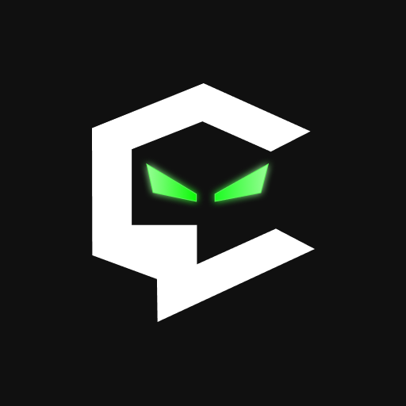

<a href="https://cayvoy.com/"><picture><source srcset="assets/logo.svg" type="image/svg+xml"></picture></a>

[English](README.md) · [Azərbaycanca](README.az.md) · [Türkçe](README.tr.md) · [Русский](README.ru.md) · [Español](README.es.md)

# Cayvoy — инструменты TikTok LIVE, приложение Windows и поддержка авторов

[Cayvoy](https://cayvoy.com/) объединяет инструменты взаимодействия со зрителями и сервисы поддержки авторов. Cayvoy App для Windows помогает работать с событиями TikTok LIVE, виджетами OBS, синтезом речи и действиями в интерактивных играх. Ссылки на Android-приложение и другие возможности платформы приведены ниже.

## Скачать Cayvoy App для Windows

- **Рекомендуется: [Cayvoy Installer — загрузить актуальную версию](https://cayvoy.com/installer/).** Во время установки загрузчик проверяет сервис релизов Cayvoy и скачивает доступную версию Windows-приложения. Используйте эту постоянную ссылку для будущих загрузок.
- **[GitHub Releases](https://github.com/cayvoycom/cayvoy.com/releases/latest)** — опубликованные portable EXE, setup EXE и installer, а также контрольные суммы SHA-256.
- **Portable** работает без обычной установки. **Setup** устанавливает приложение на компьютер. Файлы GitHub с номером версии относятся к конкретному релизу; для актуальной версии предпочтительна официальная ссылка на installer.

## Android-приложение — Google Play

[Открыть Cayvoy для Android в Google Play](https://play.google.com/store/apps/details?id=az.cayvoy). Приложения Windows и Android загружаются отдельно.

## Возможности Cayvoy

- Связь событий TikTok LIVE с триггерами, действиями и интерактивными играми.
- Виджеты и уведомления для OBS Studio и программ трансляций с браузерными источниками.
- Медиафайлы, звуки и синтез речи TTS для взаимодействия с аудиторией.
- Страницы авторов, пожертвования и варианты поддержки на [cayvoy.com](https://cayvoy.com/).

Доступность функций зависит от аккаунта, тарифа и платформы. Актуальная информация и помощь доступны на официальном сайте.

**Официальные ссылки:** [Сайт](https://cayvoy.com/) · [Windows](https://cayvoy.com/installer/) · [Android](https://play.google.com/store/apps/details?id=az.cayvoy) · [Тарифы](https://cayvoy.com/pricing) · [Контакты](https://cayvoy.com/contact)

Этот репозиторий содержит описание продукта и ссылки для загрузки. Исходный код приложения Cayvoy здесь не публикуется. Права на программу и бренд принадлежат соответствующему владельцу.
